<div align="center">

# contributions-drop

**GitHub の草で、落ち物パズルを自動プレイ。**

<picture>
  <source media="(prefers-color-scheme: dark)" srcset="https://raw.githubusercontent.com/t4kamuna/contributions-drop/output/contributions-drop-dark.svg" />
  
</picture>

**[導入](#-導入) · [盤面](#-盤面) · [snk と併用](#-snk草のヘビを使っている場合) · [仕組み](#-仕組み)**

[English](README.md) · 日本語

[](https://github.com/t4kamuna/contributions-drop/tags)
[](https://github.com/t4kamuna/contributions-drop/actions/workflows/ci.yml)
[](LICENSE)
[](action.yml)
[](src)
[](https://github.com/t4kamuna/contributions-drop/stargazers)

</div>

## ✨ 特徴

- 🟩 **草1マス = ブロック1つ。** 草が生えた日がそのままブロックになり、色はその日の濃さ。4日分で1個のミノになります。
- 🎮 **ルールは本格派。** 7種類のミノ、SRS 回転（壁際の回転補正つき）、7-bag、ライン消去。
- 🤖 **勝手に遊ぶ。** 内蔵のプレイヤーが置き場所を決めて1ゲームを最後まで進め、その様子をループする SVG アニメーションにします。
- 🔁 **同じ草なら同じゲーム。** 乱数のシードはユーザー名と年です。
- 🌗 GitHub に合わせた **ライト / ダーク** の配色。
- 🪶 **サーバー不要。** GitHub Actions で動いて SVG ファイルを書き出すだけです。[snk](https://github.com/Platane/snk)（草のヘビ）と同じ仕組みです。

## 🧱 盤面

<table>
  <tr>
    <th><code>official</code>（デフォルト）<br>10 × 20</th>
    <th><code>18x7</code></th>
    <th><code>14x7</code></th>
  </tr>
  <tr>
    <td align="center">
      <picture>
        <source media="(prefers-color-scheme: dark)" srcset="https://raw.githubusercontent.com/t4kamuna/contributions-drop/output/contributions-drop-dark.svg" />
        
      </picture>
    </td>
    <td align="center">
      <picture>
        <source media="(prefers-color-scheme: dark)" srcset="https://raw.githubusercontent.com/t4kamuna/contributions-drop/output/contributions-drop-18x7-dark.svg" />
        
      </picture>
    </td>
    <td align="center">
      <picture>
        <source media="(prefers-color-scheme: dark)" srcset="https://raw.githubusercontent.com/t4kamuna/contributions-drop/output/contributions-drop-14x7-dark.svg" />
        
      </picture>
    </td>
  </tr>
</table>

<code>graph</code> は草と同じ大きさ（週数 × 7）です。

<picture>
  <source media="(prefers-color-scheme: dark)" srcset="https://raw.githubusercontent.com/t4kamuna/contributions-drop/output/contributions-drop-graph-dark.svg" />
  
</picture>

## 🚀 導入

**1. ワークフローを追加します。** プロフィール用のリポジトリ（`<ユーザー名>/<ユーザー名>`）に置きます。

```yaml
# .github/workflows/contributions-drop.yml
name: contributions-drop
on:
  schedule:
    - cron: "0 0 * * *"
  workflow_dispatch:
jobs:
  generate:
    runs-on: ubuntu-latest
    permissions:
      contents: write
    steps:
      - uses: t4kamuna/contributions-drop@v0.1.0
        with:
          github_user_name: ${{ github.repository_owner }}
          outputs: |
            dist/contributions-drop.svg
            dist/contributions-drop-dark.svg?palette=github-dark
      - name: push to output branch
        run: |
          cd dist
          git init -q -b output
          git config user.name "github-actions[bot]"
          git config user.email "41898282+github-actions[bot]@users.noreply.github.com"
          git add .
          git commit -q -m "update contributions-drop"
          git push -f "https://x-access-token:${{ github.token }}@github.com/${{ github.repository }}.git" output
```

**2. 一度実行します。** Actions タブの「Run workflow」から手動で動かすか、毎日の自動実行を待ちます。

**3. README に貼ります。**

```html
<picture>
  <source media="(prefers-color-scheme: dark)" srcset="https://raw.githubusercontent.com/<ユーザー名>/<ユーザー名>/output/contributions-drop-dark.svg" />
  /<ユーザー名>/output/contributions-drop.svg" />
</picture>
```

### 🐍 snk（草のヘビ）を使っている場合

snk のよくある設定は、`dist/` の中身で `output` ブランチを**まるごと置き換え**ます。上のワークフローを別に追加すると、同じブランチを取り合って、ヘビかこちらのどちらかの画像が消えます。

代わりに、今ある snk のワークフローの**送信の手順より前**に1手順だけ足して、同じフォルダに書き出してください。

```yaml
      - uses: Platane/snk/svg-only@v3
        with:
          github_user_name: ${{ github.repository_owner }}
          outputs: |
            dist/github-contribution-grid-snake.svg
            dist/github-contribution-grid-snake-dark.svg?palette=github-dark

      # ⬇ これを足す
      - uses: t4kamuna/contributions-drop@v0.1.0
        with:
          github_user_name: ${{ github.repository_owner }}
          outputs: |
            dist/contributions-drop.svg
            dist/contributions-drop-dark.svg?palette=github-dark

      - uses: crazy-max/ghaction-github-pages@v3.1.0
        with:
          target_branch: output
          build_dir: dist
        env:
          GITHUB_TOKEN: ${{ github.token }}
```

## ⚙️ 入力

| 名前 | 必須 | 説明 |
| --- | --- | --- |
| `github_user_name` | ○ | 草を使うユーザー |
| `outputs` | ○ | 1行に1ファイル。`?palette=github-light`（デフォルト）か `github-dark`、`&board=...` で盤面を個別に指定 |
| `board` | | 全部の出力に使う盤面。`official`（デフォルト）、`18x7`、`14x7`、`graph` |
| `github_token` | | 省略時は `${{ github.token }}` |

複数出す例:

```yaml
outputs: |
  dist/drop.svg
  dist/drop-dark.svg?palette=github-dark
  dist/drop-wide.svg?board=graph
  dist/drop-wide-dark.svg?board=graph&palette=github-dark
```

## 🔍 仕組み

1. GitHub GraphQL API から草のデータを取ります。
2. 草が1以上ある日を古い順に並べて4日ずつに区切り、1区切りを1個のミノにします。各ブロックはその日の色を持ちます。4で割り切れない分は、最後のミノを灰色のブロックで埋めます。
3. 1ゲームを最後までシミュレーションします。ミノごとに、SRS の回転補正込みで届く「向き × 位置」を全部試し、積んだあとの盤面（高さ・穴・凸凹・消えた行）を採点して一番良い場所に置きます。
4. 結果を1枚の SVG にします。ミノ1個を `<g>` 1つにして、CSS の `@keyframes` で移動と回転をさせます。行がそろうと点滅して消え、上の段が下に詰まります。アニメーションはずっとループします。

## 🛠 手元で試す

```sh
npm ci
node --import tsx src/cli.ts --fake 0.6 --out preview.svg                 # 架空の草で
node --import tsx src/cli.ts --fake 0.6 --board 18x7 --out preview.svg
GITHUB_TOKEN=... node --import tsx src/cli.ts --user <ユーザー名> --out preview.svg
```

## 📄 ライセンス

[MIT](LICENSE)
