<div align="center">

# contributions-drop

**Your GitHub contribution graph, played as a falling-block puzzle.**

<picture>
  <source media="(prefers-color-scheme: dark)" srcset="https://raw.githubusercontent.com/t4kamuna/contributions-drop/output/contributions-drop-dark.svg" />
  
</picture>

**[Quick start](#-quick-start) · [Boards](#-boards) · [Styles](#-styles) · [Already using snk?](#-already-using-snk) · [How it works](#-how-it-works)**

English · [日本語](README.ja.md)

[](https://github.com/t4kamuna/contributions-drop/tags)
[](https://github.com/t4kamuna/contributions-drop/actions/workflows/ci.yml)
[](LICENSE)
[](action.yml)
[](src)
[](https://github.com/t4kamuna/contributions-drop/stargazers)

</div>

## ✨ Features

- 🟩 **One green square = one block.** Every day you contributed becomes a block, colored by that day's level. Four days in a row make one piece.
- 🎮 **Real rules.** Seven pieces, SRS rotation with wall kicks, 7-bag randomizer, line clears, hold, T-spins.
- 🕹 **Three play styles.** Play it safe, go for 4-line clears, or hunt T-spins.
- 🤖 **Plays itself.** A small built-in player picks where each piece goes, then the whole game is recorded as a looping SVG animation.
- 🔁 **Same graph, same game.** The randomizer is seeded with your user name and the year.
- 🌗 **Light and dark** palettes that match GitHub.
- 🪶 **No server.** It runs in GitHub Actions and writes a plain SVG file — just like [snk](https://github.com/Platane/snk).

## 🧱 Boards

<table>
  <tr>
    <th><code>official</code> (default)<br>10 × 20</th>
    <th><code>18x7</code></th>
    <th><code>14x7</code></th>
  </tr>
  <tr>
    <td align="center">
      <picture>
        <source media="(prefers-color-scheme: dark)" srcset="https://raw.githubusercontent.com/t4kamuna/contributions-drop/output/contributions-drop-dark.svg" />
        
      </picture>
    </td>
    <td align="center">
      <picture>
        <source media="(prefers-color-scheme: dark)" srcset="https://raw.githubusercontent.com/t4kamuna/contributions-drop/output/contributions-drop-18x7-dark.svg" />
        
      </picture>
    </td>
    <td align="center">
      <picture>
        <source media="(prefers-color-scheme: dark)" srcset="https://raw.githubusercontent.com/t4kamuna/contributions-drop/output/contributions-drop-14x7-dark.svg" />
        
      </picture>
    </td>
  </tr>
</table>

<code>graph</code> — the same size as your contribution graph (weeks × 7):

<picture>
  <source media="(prefers-color-scheme: dark)" srcset="https://raw.githubusercontent.com/t4kamuna/contributions-drop/output/contributions-drop-graph-dark.svg" />
  
</picture>

## 🕹 Styles

<table>
  <tr>
    <th><code>classic</code> (default)</th>
    <th><code>quad</code></th>
    <th><code>tspin</code></th>
  </tr>
  <tr>
    <td>Stack flat, clear lines right away.</td>
    <td>Keep the center column open, stack both sides, then drop an I to clear <b>4 lines</b> at once.</td>
    <td>Build T-shaped slots and spin Ts into them for <b>T-spin doubles</b>.</td>
  </tr>
  <tr>
    <td align="center">
      <picture>
        <source media="(prefers-color-scheme: dark)" srcset="https://raw.githubusercontent.com/t4kamuna/contributions-drop/output/contributions-drop-dark.svg" />
        
      </picture>
    </td>
    <td align="center">
      <picture>
        <source media="(prefers-color-scheme: dark)" srcset="https://raw.githubusercontent.com/t4kamuna/contributions-drop/output/contributions-drop-quad-dark.svg" />
        
      </picture>
    </td>
    <td align="center">
      <picture>
        <source media="(prefers-color-scheme: dark)" srcset="https://raw.githubusercontent.com/t4kamuna/contributions-drop/output/contributions-drop-tspin-dark.svg" />
        
      </picture>
    </td>
  </tr>
</table>

`quad` and `tspin` play with a **hold** box (one hold per piece, like the guideline), look one piece ahead, and show a label such as `4 LINES`, `T-SPIN DOUBLE` or `ALL CLEAR` when they land one. They need the `official` board; on the 7-row boards they fall back to `classic` with a warning.

```yaml
outputs: |
  dist/contributions-drop.svg?style=tspin
  dist/contributions-drop-dark.svg?style=tspin&palette=github-dark
```

## 🚀 Quick start

**1. Add a workflow** to your profile repository (`<you>/<you>`):

```yaml
# .github/workflows/contributions-drop.yml
name: contributions-drop
on:
  schedule:
    - cron: "0 0 * * *"
  workflow_dispatch:
jobs:
  generate:
    runs-on: ubuntu-latest
    permissions:
      contents: write
    steps:
      - uses: t4kamuna/contributions-drop@v0.2.0
        with:
          github_user_name: ${{ github.repository_owner }}
          outputs: |
            dist/contributions-drop.svg
            dist/contributions-drop-dark.svg?palette=github-dark
      - name: push to output branch
        run: |
          cd dist
          git init -q -b output
          git config user.name "github-actions[bot]"
          git config user.email "41898282+github-actions[bot]@users.noreply.github.com"
          git add .
          git commit -q -m "update contributions-drop"
          git push -f "https://x-access-token:${{ github.token }}@github.com/${{ github.repository }}.git" output
```

**2. Run it once** from the Actions tab (*Run workflow*), or wait for the daily schedule.

**3. Embed it** in your `README.md`:

```html
<picture>
  <source media="(prefers-color-scheme: dark)" srcset="https://raw.githubusercontent.com/<you>/<you>/output/contributions-drop-dark.svg" />
  /<you>/output/contributions-drop.svg" />
</picture>
```

### 🐍 Already using snk?

Most snk setups push their `dist/` folder to the `output` branch and **replace the whole branch** every time. A second workflow pushing to the same branch would wipe the snake (or vice versa).

Instead, add one step to your existing snk workflow, **before** the push step, writing into the same folder:

```yaml
      - uses: Platane/snk/svg-only@v3
        with:
          github_user_name: ${{ github.repository_owner }}
          outputs: |
            dist/github-contribution-grid-snake.svg
            dist/github-contribution-grid-snake-dark.svg?palette=github-dark

      # ⬇ add this
      - uses: t4kamuna/contributions-drop@v0.2.0
        with:
          github_user_name: ${{ github.repository_owner }}
          outputs: |
            dist/contributions-drop.svg
            dist/contributions-drop-dark.svg?palette=github-dark

      - uses: crazy-max/ghaction-github-pages@v3.1.0
        with:
          target_branch: output
          build_dir: dist
        env:
          GITHUB_TOKEN: ${{ github.token }}
```

## ⚙️ Inputs

| name | required | description |
| --- | --- | --- |
| `github_user_name` | yes | User whose graph is used |
| `outputs` | yes | One file per line. Options as a query string: `?palette=github-light` (default) or `github-dark`, `&board=...` to override the board |
| `board` | no | Default board for all outputs: `official` (default), `18x7`, `14x7`, `graph` |
| `style` | no | Default play style: `classic` (default), `quad`, `tspin`. Per output: `&style=...` |
| `github_token` | no | Defaults to `${{ github.token }}` |

Example with several outputs:

```yaml
outputs: |
  dist/drop.svg
  dist/drop-dark.svg?palette=github-dark
  dist/drop-wide.svg?board=graph
  dist/drop-wide-dark.svg?board=graph&palette=github-dark
```

## 🔍 How it works

1. Fetch your contribution calendar from the GitHub GraphQL API.
2. Take the days with at least one contribution, oldest first, and split them into groups of four. Each group becomes one piece; each block keeps its day's color. If the count is not a multiple of four, the last piece is filled with gray blocks.
3. Simulate a full game. With `quad` and `tspin` it also tries holding the piece, and looks one piece ahead (keeping the best 8–12 candidates). T-spins are detected with the three-corner rule. For each piece, the player searches every rotation and position it can reach (with SRS kicks) and scores the resulting board (height, holes, bumpiness, cleared lines).
4. Write the game as one SVG. Each piece is a `<g>` moved and rotated with CSS `@keyframes`; line clears blink and drop the rows above. The animation loops forever.

## 🛠 Local preview

```sh
npm ci
node --import tsx src/cli.ts --fake 0.6 --out preview.svg                 # made-up graph
node --import tsx src/cli.ts --fake 0.6 --board 18x7 --out preview.svg
node --import tsx src/cli.ts --fake 0.6 --style tspin --out preview.svg
GITHUB_TOKEN=... node --import tsx src/cli.ts --user <name> --out preview.svg
```

## 📄 License

[MIT](LICENSE)
